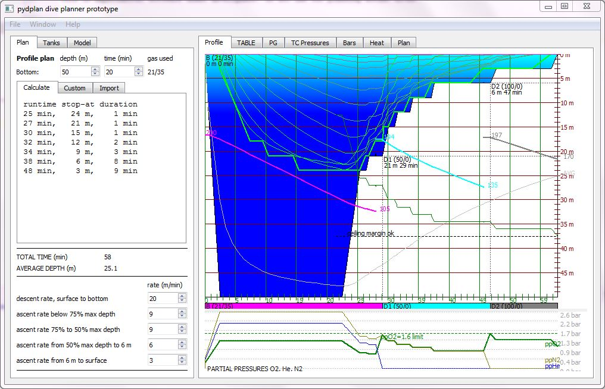

# PyDplan = Python Dive PLANner
## 2025-10-10 update
The Python source code has been updated such that the app will run on Python 3.14 and latest PyQt5 GUI library.
Following changes have been made:
- Many calls to Qt drawing functions had no type checking but require int arguments. Earlier py versions apparently silently converted floats to ints, but py 3.14 requires you do the dirty work or are more diligent. Now the args are for sure converted to int.
- Added type hints
- Added lots of doc strings

This code was first developed in 2018 for py 3.6.
Note that there is also a Web-Javascript implementation that reuses some of the concepts of this Python app. That code was done 2021. 
Look at: https://github.com/eianlei/scalc

There would also be the newer PyQt6, but that has many breaking changes. PySide6 is sadly also not 100% compatible.

## Introduction
Pydplanner is a Graphical User Interface application for the desktop (Windows, Linux, MAC, etc)
for planning mixed gas staged decompression technical scuba dives. 
Pydplanner can be used for interactive planning of decompression dives using the Bühlmann algorithm.
It is particularily intended for learning and understanding how the Bühlmann algorithm for decompression modeling works.

Pydplan is written in Python 3.6 and the GUI is using PyQt5 library for graphics.

There is also a "branch" of PyDplan called SCALC that works as a web application. It is a transpilation of Python source code to JavaScript, and the GUI implemented by HTML5, CSS and Javascript.
See the SCALC project is at https://github.com/eianlei/scalc

## FillCalc2
FillCalc2.py is an auxiliary tool in this package for interactive gas mixing calculations.

See [FillCalc2 documentations](/doc/fillcalc2.md) for more details about it.

## modCalc2
modCalc2.py is an auxiliary tool in this package for interactive MOD calculation.

See [modCalc2 documentations](/doc/modcalc2.md) for more details about it.

# DISCLAIMER!
This is experimental prototype software under development! Do not use for planning actual dives!

THIS IS A NEW IMPLEMENTATION OF THE BUHLMANN ALGORITHM AND A DIVE PLANNER IMPLEMENTATION BASED ON THAT WHICH HAS RECEIVED ONLY A LIMITED AMOUNT OF TESTING. THE AUTHOR STRONGLY RECOMMENDS NOT TO PLAN DIVES SIMPLY BASED ON THE RESULTS GIVEN BY THIS APPLICATION!

Use this application at your own risk, the author provides no guarantees about the correctness of the application, and assumes no liability for the use of it for any purpose!
* In no event should you consider scuba diving with mixed gases without proper training!
* Ignoring these warnings can cause your **death** or **serious and permanent injuries**!

# INSTALLATION
[Installation instructions](/doc/installation_v2.md)

# USER MANUAL
[user manual](/doc/user_manual_v2.md)

# Source Code documentation

[Source Code documentation](/doc/source_docs.md)
