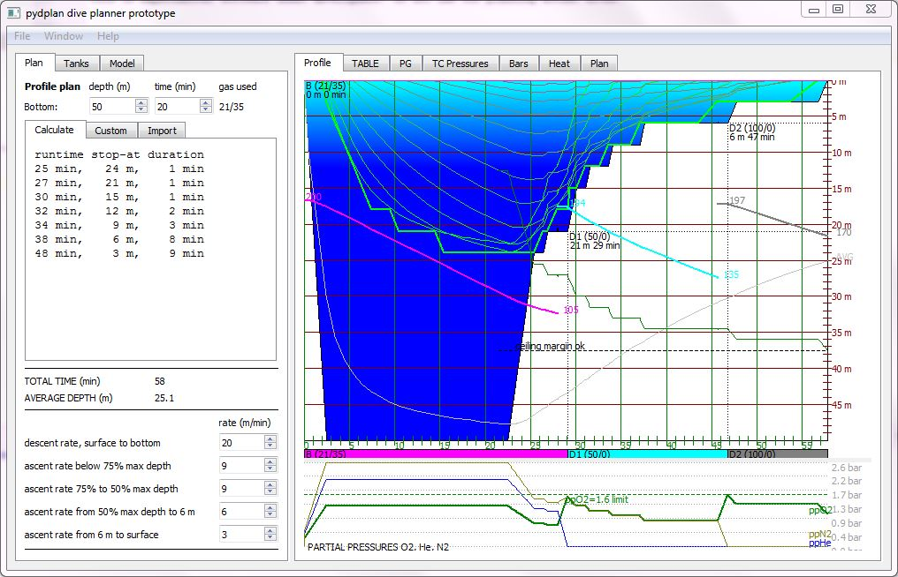

# How to install PYDPLANNER


## Installation instructions

pydplan is written in Python. Originally for 3.6 but refactored to 3.14. It will probably run on any Python environment supporting at least version 3.6. The GUI depends on [PyQt5](https://pypi.python.org/pypi/PyQt5) (Qt version 5 bindings for Python 3). It will run on Windows and most Linux GUI desktops.

To install and run the application there are following prerequisites:

- install Python version 3.6 or newer to your system
- recommend Python 3.14 though
- install PyQt5 package (for the GUI)
- clone the source files from github
  - if you do not have git, then it stronly recommended to get git before this step, 
  - see: [Simple Git guide](http://rogerdudler.github.io/git-guide/)
- run the app

## Install Python, general info

https://docs.python.org/3/tutorial/index.html 

## Python &amp; PyQt5 for Windows

Python is not by default in Windows, so you will need to install it separately.

Install latest Python:

[https://www.python.org/downloads/windows/](https://www.python.org/downloads/windows/)

Install pyqt5 from Command Prompt
```
python -m pip install pyqt5
```

## Python &amp; PyQt5 for Linux

Often Python is already installed in many Linux distributions, so you might not need to do anything here. So check first that if your system already has Python 3. From command line &quot;python3 –version&quot;. You should see version 3.6 or later to use pydplan.

Install latest Python:

[https://www.python.org/downloads/source/](https://www.python.org/downloads/source/)

PytQt5 is an extra package, so you need to install pyqt5 separately using pip. However in Linux hosts it strongly recommend to use Virtual Environments (venv). And unless you have root or sudo priviledge, you must use venv.
```
# if you are root or sudoer and really want to do this
sudo pip3 install PyQt5
```
Use venv instead
```

mkdir my_project
cd my_project
python3 -m venv venv
# This creates a folder named venv containing the virtual environment.
source venv/bin/activate
pip3 install PyQt5
# deactivate venv when done
deactivate
```

# Get sources from github

If you have git command line client in your system, the following command will clone you the pydplan source repository to you system:
```
git clone https://github.com/eianlei/pydplan.git
```
## Download ZIP

In a Windows system you do not have GIT installed by default, so a quick and dirty alternative is to simply download the sources from the GitHub project page by selecting from &quot;Clone or download&quot;, &quot;Download ZIP&quot;, to get all the source files in one archive:

    pydplan-master.zip

Which then needs to be unzipped.
But it is much better to use git, because you can get updates much easier by issuing git pull commands.

## Get updates
To get the latest updated version from the git master branch to you local cloned repo, you give the following command:
```
git pull https://github.com/eianlei/pydplan.git master
```

# Run application:

Once you have done all previous steps you should be able to launch the application by issuing the following command in Windows Command Prompt or Linux terminal, in the directory where you cloned the pydplan sources:
```
python pydplan_main.py
```
You should now see the application main window appearing:



For instructions how to use the app, see
[user manual](user_manual.md)
